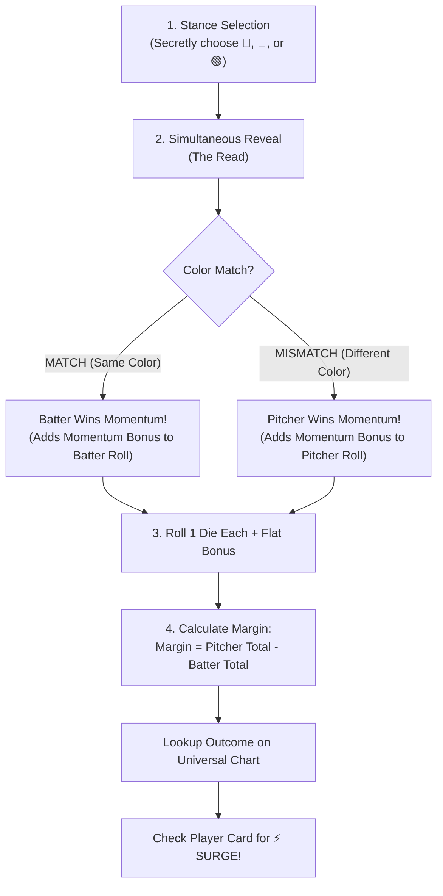

# Full Count — Official Tabletop Rulebook (Version 5)

## 1. Overview & Components

*Full Count* is a head-to-head tabletop baseball duel where each manager commands a starting lineup of **9 Batters** and an active **Pitching Staff** (Starting Pitchers, Bullpen Relievers, and Closers).

### Game Components
* **Two Team Rosters (18 Player Half-Cards per side):**
  * 9 Position Players / Batters
  * 3 Starting Pitchers (`SP`), 2 Relief Pitchers (`RP`), 1 Closer (`CL`)
* **Stance Hands (3 Half-Cards per Manager):**
  * 🔴 **Red Card** (Pitcher: *Heat / Velocity* • Batter: *Power Swing*)
  * 🔵 **Blue Card** (Pitcher: *Zone / Command* • Batter: *Eye / Take / Discipline*)
  * 🟢 **Green Card** (Pitcher: *Break / Movement* • Batter: *Contact Swing*)
* **Polyhedral Attribute Dice:** A standard tabletop set (`d4`, `d6`, `d8`, `d10`, `d12`).
* **Momentum Tokens & 8mm Wooden Cubes:** To track each active player’s Momentum Ladder.
* **11" × 17" Manager Playmats:** Featuring the Universal At-Bat Outcome Table, Bullpen/Dugout areas, and 9 Lineup slots.

---

## 2. Player Anatomy & Card Structure

Every player card displays their **Single Core Attribute Die** for each color, their physical **Momentum Ladder**, and their unique **Card Identity** (Surge Trigger, Locked-In Perk, and Special Ability):

### Attribute Dice Mapping
* **Pitchers:**
  * 🔴 **Red:** Velocity (`VEL`) Die (`d6` to `d12`)
  * 🔵 **Blue:** Command (`CMD`) Die (`d6` to `d12`)
  * 🟢 **Green:** Movement (`MOV`) Die (`d6` to `d12`)
* **Batters:**
  * 🔴 **Red:** Power (`POW`) Die (`d4` to `d12`)
  * 🔵 **Blue:** Eye (`EYE`) Die (`d4` to `d12`)
  * 🟢 **Green:** Contact (`CON`) Die (`d4` to `d12`)
  * 🏃 **Speed:** `SPD` Die (`d4` to `d12`)

```
┌────────────────────────────────────────────────────────┐
│ [POS]  PLAYER NAME                         [TEAM LOGO] │
├────────────────────────────────────────────────────────┤
│ 🔴 RED: DIE          🔵 BLUE: DIE       🟢 GREEN: DIE  │
│ SPEED: DIE (Batters)                                   │
├────────────────────────────────────────────────────────┤
│ MOMENTUM LADDER (Inverted: High on Left, Low on Right):│
│ [ L3 🔥 (+5) ]  [ L2 ★ (+3) ]  [ L1 (+2) ]  [ ✕ EXH (+0) ]│
│                                                        │
│ ⚡ SURGE: [Personalized trigger that slides cube LEFT]  │
│ 🔥 LOCKED IN: [Amplified superpower when at Level 3]   │
│ ★ ABILITY (Spend 1 Level): [Slides cube RIGHT]         │
└────────────────────────────────────────────────────────┘
```

---

## 3. The Turn Sequence (Every At-Bat)

Each plate appearance resolves in 4 rapid steps taking approximately **5 seconds**:



### Step 1: Pre-Pitch & Stance Selection
* The defense may make a bullpen pitching change.
* Either manager may declare their active player's **Special Ability** by paying **1 Level** down on their Momentum Ladder (`L3 → L2`, `L2 → L1`, or `L1 → Exhausted`).
* Both managers secretly choose one card from their 3-card hand:
  * **Pitcher chooses pitch type:** 🔴 Heat (`VEL`), 🔵 Zone (`CMD`), or 🟢 Break (`MOV`).
  * **Batter chooses approach:** 🔴 Power Swing (`POW`), 🔵 Eye / Take (`EYE`), or 🟢 Contact Swing (`CON`).

### Step 2: The Read (Simultaneous Reveal)
Both managers flip their chosen cards simultaneously:
* **🎯 MATCH (Same Color):** **Batter Reads the Pitch!** The batter anticipated the pitch location/type and earns their **Momentum Bonus** (`+5`, `+3`, `+2`, or `+0`).
* **🌀 MISMATCH (Different Colors):** **Pitcher Fools the Batter!** The pitcher crossed up the batter and earns their **Momentum Bonus** (`+5`, `+3`, `+2`, or `+0`).

### Step 3: Roll the Dice (1 Die per Player)
* **Pitcher rolls:** The single attribute die matching their chosen color (`VEL`, `CMD`, or `MOV`) + Pitcher Momentum Bonus (if won).
* **Batter rolls:** The single attribute die matching their chosen color (`POW`, `EYE`, or `CON`) + Batter Momentum Bonus (if won).
* Apply any flat modifiers from activated Special Abilities (`+2` or `+3`).

### Step 4: Calculate Margin & Resolve
$$\text{Margin} = (\text{Pitcher Total}) - (\text{Batter Total})$$
Look up the Margin on the **Universal At-Bat Outcome Table** according to the **Batter's Chosen Approach Color**.

---

## 4. Universal At-Bat Outcome Table

The central table is universal and fixed. There are no player exceptions on this chart:

| Margin | 🔴 Red (Power Swing) | 🟢 Green (Contact Swing) | 🔵 Blue (Eye / Take) |
| :---: | :--- | :--- | :--- |
| **$\ge +2$** | **STRIKEOUT (K)** *(Whiff)* | **ROUTINE OUT** *(K-Protected)* | **ROUTINE OUT** |
| **$+1 \dots 0$**| **ROUTINE OUT** | **ROUTINE OUT** | **ROUTINE OUT** |
| **$-1$** | **SAC OUT** *(R3 Scores!)* | **SAC OUT** *(R3 Scores!)* | **WALK (BB)** |
| **$-2$** | **WALK (BB)** | **WALK (BB)** | **WALK (BB)** |
| **$-3$** | **CLEAN SINGLE** | **CLEAN SINGLE** *(Capped 1B)* | **WALK (BB)** |
| **$-4$** | **CLEAN SINGLE** | **CLEAN SINGLE** *(Capped 1B)* | **CLEAN SINGLE** |
| **$\le -5$** | **EXTRA-BASE / HR** *(Roll `POW`)*| **CLEAN SINGLE** *(Capped 1B)* | **CLEAN SINGLE** |

### Extra-Base Hit Resolution (Margin $\le -5$ on 🔴 Red Power)
When a Power Swing beats the pitch by 5 or more, roll the batter's **`POW` die**:
* **`1 to 5`:** **DOUBLE (2B)** — Runners on 2nd and 3rd score; runner on 1st advances to 3rd.
* **`6`:** **TRIPLE (3B)** — All baserunners score; batter to 3rd base.
* **`7 or higher`:** **HOME RUN (HR)** — Batter and all baserunners score! *(Requires `d8`, `d10`, or `d12` `POW` unless boosted by a Locked-In state or ability).*

### Baserunner Speed Option (Singles)
When a Clean Single is hit with a runner on **2nd base**:
* **Hold at 3rd:** Runner advances safely to 3rd (no risk).
* **Send Home:** Roll the runner's **Speed (`SPD`) die**:
  * **`4+`:** **SAFE AT HOME!** Runner scores (+1 Run).
  * **`1–3`:** **OUT AT THE PLATE!** Runner is thrown out (+1 Out).

---

## 5. Inverted Momentum Ladders, Surges & Locked In Status

The Momentum Ladder is **Inverted: High on the Left, Low on the Right**, creating a natural intuitive physical progression where climbing toward peak flow slides leftward into the fiery red Level 3 slot, while fatigue drops rightward toward grey exhaustion.

### The 4 Ladder Levels (Left to Right)
* **Level 3 (`L3 🔥`): LOCKED IN** (Far Left) — `+5` Momentum Bonus + Player Superpower Unlocked!
* **Level 2 (`L2 ★`): PRIME** (Middle-Left) — `+3` Momentum Bonus (Stars start here).
* **Level 1 (`L1`): READY** (Middle-Right) — `+2` Momentum Bonus (Role players start here).
* **Level 0 (`✕ EXH`): EXHAUSTED** (Far Right) — `+0` Bonus (Abilities locked; cannot spend fuel).

### Asymmetric Ladder Tiers Across the Roster
* **Superstars & Aces (4-Slot Ladder):** `[L3 🔥 (+5)] ← [L2 ★ (+3)] ← [L1 (+2)] ← [✕ EXH (+0)]` *(Starts at L2, can surge LEFT into Locked In!)*
* **Everyday Starters (3-Slot Ladder):** `[L2 ★ (+3)] ← [L1 (+2)] ← [✕ EXH (+0)]` *(Starts at L2 or L1, max L2).*
* **Role Players & Underdogs (2-Slot Ladder):** `[L1 ★ (+2)] ← [✕ EXH (+0)]` *(Starts at L1, one-shot fuel).*

### How Surges Work (Printed on Each Player Card)
A **`⚡ SURGE`** occurs immediately when a player executes their signature strength during play:
* If the player is currently below their maximum ladder box, **slide their wooden cube one slot to the LEFT** (toward Level 3 🔥).
* **Hitting Level 3 (`L3 🔥`):** When a Tier-1 superstar surges while already at Level 2, they achieve **LOCKED IN 🔥** status!
* **Spending Fuel / Fatigue:** Activating a Special Ability slides the cube **one slot to the RIGHT** (toward Exhaustion). A Locked In player who spends fuel drops rightward to Level 2 (Prime), remaining dangerous.

---

## 5.1 Component Standards: Half-Size Cards & 11x17 Playmats

* **Half-Size Player Cards (1.82" × 2.52" Mini Cards):** All 30 players and reference cards are formatted as half-size mini cards, allowing entire 15-player team rosters to fit on a single 8.5" × 11" printable sheet.
* **11×17 Playmat with 9-Card Lineup Tray:** Each team has a dedicated 11" × 17" Manager Playmat. Across the entire bottom edge sits a 9-slot batting order track where all 9 half-size player cards line up side-by-side in batting order!
* **2-Sheet Easy Home Printing:** Each 11" × 17" playmat is split into two standard 8.5" × 11" Letter sheets (Left Half & Right Half) with overlap alignment marks (`✛`), allowing any standard home printer to produce full-size 11" × 17" tournament-grade playmats with zero trimming hassle.

---

## 6. Pitcher Fatigue & Bullpen Management

Pitchers face realistic baseball fatigue governed by **Times Through the Order (TTO)** and bullpen stamina:

1. **Times Through the Order (Starting Pitchers):**
   * Starters begin at their printed Level (Aces at `L2`).
   * **2nd Time Facing Opposing #1 Leadoff:** The starter drops **1 Level** (`L2 → L1`).
   * **3rd Time Facing Opposing #1 Leadoff:** The starter drops **1 Level** (`L1 → Exhausted`).
   * **High-Stress Rally:** If a starter allows 3+ runs in a single half-inning, they immediately drop 1 Level.
2. **Bullpen Relievers (`RP` & `CL`):**
   * Relievers enter the game fresh at their printed Level (Setup relievers at `L1` or `L2`, Closers at `L2`).
   * **Single-Inning Stamina:** Relievers are maximum-effort arms. If a reliever remains on the mound for a **second inning**, they drop **1 Level** at the start of that inning.

---

## 7. Official Team Rosters

### Team 1: The Metro Titans
* **SP "Apex" Garrison (Ace • 4-Box Ladder • Starts L2):** 🔴 VEL d12 • 🔵 CMD d6 • 🟢 MOV d8
  * `⚡ SURGE:` On Strikeout with Margin $\ge +3$.
  * `🔥 LOCKED IN:` Opponents rolling Red Power against his fastball roll with Disadvantage (roll 2 dice, take lower).
  * `★ ABILITY (1 Lvl):` *Sonic Boom* — Reroll pitch die and keep higher result.
* **SP "Brick" Kowalski (Sinker SP • 3-Box Ladder • Starts L2):** 🔴 VEL d8 • 🔵 CMD d8 • 🟢 MOV d10
  * `⚡ SURGE:` When inducing a Sac/Fielded Groundout.
  * `★ ABILITY (1 Lvl):` *Iron Sink* — +2 to roll; Sac outs advance zero runners.
* **SP Dakota Ridge (Workhorse SP • 2-Box Ladder • Starts L1):** 🔴 VEL d6 • 🔵 CMD d8 • 🟢 MOV d6
  * `★ ABILITY (1 Lvl):` *Inning Eater* — +2 to pitch roll.
* **RP "Spitfire" Ramos (Setup RP • 3-Box Ladder • Starts L2):** 🔴 VEL d10 • 🔵 CMD d4 • 🟢 MOV d8
  * `⚡ SURGE:` On any Strikeout.
  * `★ ABILITY (1 Lvl):` *Flamethrower* — +2 to pitch roll.
* **RP "Lefty" Vance (Middle RP • 2-Box Ladder • Starts L1):** 🔴 VEL d6 • 🔵 CMD d8 • 🟢 MOV d8
  * `★ ABILITY (1 Lvl):` *Southpaw Sweep* — +2 to pitch roll.
* **CL "The Beast" Tanker (Closer • 4-Box Ladder • Starts L2):** 🔴 VEL d12 • 🔵 CMD d4 • 🟢 MOV d8
  * `⚡ SURGE:` On any Strikeout.
  * `🔥 LOCKED IN:` Opponents cannot use Batter Special Abilities while Tanker is Locked In.
  * `★ ABILITY (1 Lvl):` *Lights Out* — Automatically claim the Momentum advantage for this at-bat.
* **CF "Flash" Mercer (4-Box Ladder • Starts L2):** 🔴 POW d6 • 🔵 EYE d10 • 🟢 CON d10 • 🏃 SPD d12
  * `⚡ SURGE:` Scores a run or advances 2 bases on a Single.
  * `🔥 LOCKED IN:` Takes 2 extra bases on any hit without a roll.
  * `★ ABILITY (1 Lvl):` *Rabbit Jump* — +2 to roll.
* **RF Aaron Vance (4-Box Ladder • Starts L2):** 🔴 POW d10 • 🔵 EYE d8 • 🟢 CON d10 • 🏃 SPD d8
  * `⚡ SURGE:` Hits a Clean Single or Extra-Base Hit (Margin $\le -3$).
  * `🔥 LOCKED IN:` Upgrades any Single into a Double.
  * `★ ABILITY (1 Lvl):` *Pure Barrel* — +2 to roll; immune to Strikeouts.
* **LF Corbin Reyes (4-Box Ladder • Starts L2):** 🔴 POW d8 • 🔵 EYE d8 • 🟢 CON d10 • 🏃 SPD d6
  * `⚡ SURGE:` Drives in an RBI with 2 outs.
  * `🔥 LOCKED IN:` Adds +4 to all Contact and Power rolls.
  * `★ ABILITY (1 Lvl):` *Clutch Drive* — +3 to roll.
* **1B "Colossus" Stone (4-Box Ladder • Starts L2):** 🔴 POW d12 • 🔵 EYE d4 • 🟢 CON d6 • 🏃 SPD d4
  * `⚡ SURGE:` Hits a Home Run (Margin $\le -5$, `POW 7+`).
  * `🔥 LOCKED IN:` Moonshot Frenzy — Extra-Base Hits become HRs on `POW 5+`.
  * `★ ABILITY (1 Lvl):` *Moonshot* — +3 to roll.
* **3B Marcus Cole (3-Box Ladder • Starts L1):** 🔴 POW d8 • 🔵 EYE d6 • 🟢 CON d8 • 🏃 SPD d6
  * `⚡ SURGE:` Drives in an RBI with RISP.
  * `★ ABILITY (1 Lvl):` *Hot Corner* — +2 to roll.
* **C "Blue Collar" Dan (2-Box Ladder • Starts L1):** 🔴 POW d6 • 🔵 EYE d6 • 🟢 CON d8 • 🏃 SPD d6
  * `★ ABILITY (1 Lvl):` *Gritty AB* — +2 to roll; Margin +1 out becomes a Sac Out.
* **2B Toby Chen (2-Box Ladder • Starts L1):** 🔴 POW d4 • 🔵 EYE d6 • 🟢 CON d8 • 🏃 SPD d8
  * `★ ABILITY (1 Lvl):` *Gap Spark* — +2 to roll.
* **SS "Glove-Man" Pete (2-Box Ladder • Starts L1):** 🔴 POW d4 • 🔵 EYE d4 • 🟢 CON d6 • 🏃 SPD d6
  * `★ ABILITY (1 Lvl):` *Contact Poke* — +2 to roll.
* **DH Eli "The Kid" (2-Box Ladder • Starts L1):** 🔴 POW d4 • 🔵 EYE d4 • 🟢 CON d4 • 🏃 SPD d6
  * `★ ABILITY (1 Lvl):` *Underdog Spark* — Roll an extra +d6 bonus die to your roll.

---

### Team 2: The Shadow Serpents
* **SP "Professor" Webb (Ace • 4-Box Ladder • Starts L2):** 🔴 VEL d6 • 🔵 CMD d12 • 🟢 MOV d10
  * `⚡ SURGE:` Margin +2 called Strikeout.
  * `🔥 LOCKED IN:` Eliminates opponent's walk window; all Walks become Groundouts.
  * `★ ABILITY (1 Lvl):` *Black Paint* — +2 to roll; Margin -3 Walk becomes a Fielded Out.
* **SP "Ghost" Strider (Strikeout SP • 3-Box Ladder • Starts L1):** 🔴 VEL d8 • 🔵 CMD d8 • 🟢 MOV d8
  * `⚡ SURGE:` On any Strikeout.
  * `★ ABILITY (1 Lvl):` *Tunneling* — Reroll pitch die and keep higher result.
* **SP "Cold-Eye" Carter (Poise SP • 3-Box Ladder • Starts L2):** 🔴 VEL d6 • 🔵 CMD d10 • 🟢 MOV d6
  * `⚡ SURGE:` Induces a weak Routine Out with runner on 3rd.
  * `★ ABILITY (1 Lvl):` *Veteran Poise* — +2 to roll; downgrades Extra-Base Hits to Singles.
* **RP "Submarine" Skenes (Setup RP • 3-Box Ladder • Starts L2):** 🔴 VEL d8 • 🔵 CMD d6 • 🟢 MOV d10
  * `⚡ SURGE:` Induces a Fielded/Sac Out.
  * `★ ABILITY (1 Lvl):` *Rising Slider* — +2 to roll.
* **RP "Icebox" Keller (Middle RP • 2-Box Ladder • Starts L1):** 🔴 VEL d6 • 🔵 CMD d10 • 🟢 MOV d6
  * `★ ABILITY (1 Lvl):` *Fireman* — +2 to roll.
* **CL Shohei "Viper" Cruz (Closer • 4-Box Ladder • Starts L2):** 🔴 VEL d8 • 🔵 CMD d8 • 🟢 MOV d12
  * `⚡ SURGE:` On any Strikeout.
  * `🔥 LOCKED IN:` Automatically claims the Momentum advantage for the remainder of the inning.
  * `★ ABILITY (1 Lvl):` *Nasty Bite* — +3 to pitch roll.
* **LF "Professor" Soto (4-Box Ladder • Starts L2):** 🔴 POW d6 • 🔵 EYE d12 • 🟢 CON d10 • 🏃 SPD d8
  * `⚡ SURGE:` Draws a Walk on a 🔵 Blue Eye card.
  * `🔥 LOCKED IN:` Completely immune to Strikeouts; matches against Blue automatically result in a Walk or Single.
  * `★ ABILITY (1 Lvl):` *Eagle Eye* — +2 to roll; draws Walk on Margin 0 to -3.
* **DH Shohei "Viper" Cruz (4-Box Ladder • Starts L2):** 🔴 POW d10 • 🔵 EYE d10 • 🟢 CON d10 • 🏃 SPD d10
  * `⚡ SURGE:` Hits an Extra-Base Hit or 2-out RBI hit.
  * `🔥 LOCKED IN:` Automatically claims the Momentum advantage on every at-bat.
  * `★ ABILITY (1 Lvl):` *Five-Tool Genius* — Automatically wins the Pitch Read.
* **SS Gunnar Henderson (4-Box Ladder • Starts L2):** 🔴 POW d8 • 🔵 EYE d8 • 🟢 CON d10 • 🏃 SPD d8
  * `⚡ SURGE:` Hits a Double or Triple.
  * `🔥 LOCKED IN:` All Clean Singles are automatically upgraded into Doubles.
  * `★ ABILITY (1 Lvl):` *Gap Hunter* — +2 to roll; upgrades Clean Single to Double.
* **1B Bryce Harper (4-Box Ladder • Starts L2):** 🔴 POW d10 • 🔵 EYE d8 • 🟢 CON d8 • 🏃 SPD d6
  * `⚡ SURGE:` Hits a Home Run or extra-base hit.
  * `🔥 LOCKED IN:` Showtime — Adds +4 to all rolls; HR on `POW 6+`.
  * `★ ABILITY (1 Lvl):` *Showtime* — +3 to roll.
* **3B Manny Machado (3-Box Ladder • Starts L1):** 🔴 POW d8 • 🔵 EYE d6 • 🟢 CON d8 • 🏃 SPD d6
  * `⚡ SURGE:` Drives in an RBI with RISP.
  * `★ ABILITY (1 Lvl):` *Line Drive* — +2 to roll.
* **CF Francisco Lindor (3-Box Ladder • Starts L1):** 🔴 POW d6 • 🔵 EYE d6 • 🟢 CON d8 • 🏃 SPD d8
  * `⚡ SURGE:` Hits a Single and advances on Speed roll.
  * `★ ABILITY (1 Lvl):` *Mr. Smile* — +2 to roll.
* **2B Nico Hoerner (3-Box Ladder • Starts L1):** 🔴 POW d4 • 🔵 EYE d6 • 🟢 CON d10 • 🏃 SPD d8
  * `⚡ SURGE:` Hits a Contact Single on a 🟢 Green card.
  * `★ ABILITY (1 Lvl):` *Bat Control* — Reroll contact die and keep higher result.
* **C Austin Hedges (2-Box Ladder • Starts L1):** 🔴 POW d4 • 🔵 EYE d6 • 🟢 CON d6 • 🏃 SPD d4
  * `★ ABILITY (1 Lvl):` *Veteran Eye* — +2 to roll.
* **RF Leo "The Spark" (2-Box Ladder • Starts L1):** 🔴 POW d4 • 🔵 EYE d4 • 🟢 CON d4 • 🏃 SPD d8
  * `★ ABILITY (1 Lvl):` *Pure Hustle* — Roll an extra +d6 bonus die to your roll.
